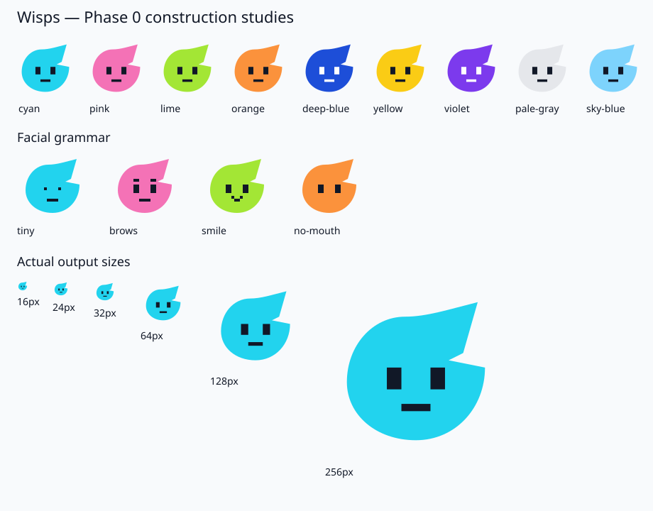

# Phase 0 — Wisp Visual Specification

This is the initial design specification for static Wisps. It translates the repository's written brief into normalized geometry. No reference image was supplied; the examples below are proposed construction studies. Genome generation and production rendering belong to later phases. These values remain draft until the version 1 freeze.

## Canonical silhouette

A Wisp has a round lower body, an asymmetric pointed projection toward the upper right, and a visible notch on its right side. Use a flat fill with no outline, gradients, shadows, or texture by default. The face sits inside the round body, away from the tip and notch.

Build the outline from reusable named anchors and Bézier curves. Facial features and accessories use rectangles, stepped polygons, circles, and lines. Keep the defining tip and notch when introducing body variants; avoid seed-specific arbitrary paths.

| Anchor | Position | Purpose |
| --- | --- | --- |
| Crown | (44, 20) | Start of the rounded upper body. |
| Tip | (84, 12) | Upper-right projection. |
| Tip return | (76, 40) | Inner edge returning toward the body. |
| Notch | (68, 44) | Concave right-side cutout. |
| Right shoulder | (88, 48) | Outer edge below the notch. |
| Bottom | (50, 88) | Round lower body. |
| Left | (12, 56) | Left body extremum. |

The canonical construction uses this closed outline in normalized units:

```text
M 44 20
C 56 20, 68 16, 84 12
L 76 40
L 68 44
L 88 48
C 88 70, 72 88, 50 88
C 28 88, 12 74, 12 56
C 12 36, 26 20, 44 20
Z
```

Use this as a shared body geometry definition in the later renderer. It is a design example, not a production renderer. Delay variation ranges until the canonical shape is visually approved; notch depth, tip angle, and roundness must stay subtle.

## Coordinate system and safe zones

Use an SVG `viewBox="0 0 100 100"`. The origin is at the top left; positive x points right and positive y points down. Convert normalized units to output pixels with `value * size / 100`. Keep geometry in normalized units rather than scattering output pixel coordinates through renderers.

| Region | Normalized bounds | Rule |
| --- | --- | --- |
| Canvas | x = 0–100, y = 0–100 | Includes padding and future accessories. |
| Body | x = 12–88, y = 12–88 | Tip reaches y = 12; lower body reaches y = 88. |
| Face safe area | x = 30–70, y = 40–72 | All primary facial features fit here. |
| Brows | x = 32–68, y = 40–44 | Separate layer above eyes. |
| Eyes | x = 32–68, y = 48–60 | Reserve separation between both eyes. |
| Mouth | x = 40–60, y = 64–72 | Small enough to remain secondary to eyes. |
| Upper accessory area | x = 24–64, y = 8–36 | Avoid the tip and facial safe area. |

The face safe area is an envelope, not a requirement to fill every edge. Center the face around x = 50. Keep at least one facial unit of vertical space between brows and eyes, and between eyes and mouth. Glasses may intersect the eye region; other accessories must not cover it. Accessory shapes remain within the canvas and should leave the tip and notch recognizable.

## Curated palette and contrast

Use stable palette IDs. Each entry implements the future `WispColor` contract:

```ts
interface WispColor {
  id: string
  body: string
  preferredFaceColors: string[]
}
```

The preferred face color is listed below; store it as a one-element array initially. Ratios were calculated from sRGB relative luminance. Use at least 4.5:1 for facial marks against the body as this project's design threshold. Recheck any later color override or accessory lens color against its immediate background.

| ID | Body | Preferred face color | Contrast |
| --- | --- | --- | --- |
| `cyan` | `#22D3EE` | `#111827` | 9.82:1 |
| `pink` | `#F472B6` | `#111827` | 6.70:1 |
| `lime` | `#A3E635` | `#111827` | 11.77:1 |
| `orange` | `#FB923C` | `#111827` | 7.84:1 |
| `deep-blue` | `#1D4ED8` | `#FFFFFF` | 6.70:1 |
| `yellow` | `#FACC15` | `#111827` | 11.58:1 |
| `violet` | `#7C3AED` | `#FFFFFF` | 5.70:1 |
| `pale-gray` | `#E5E7EB` | `#111827` | 14.33:1 |
| `sky-blue` | `#7DD3FC` | `#111827` | 10.64:1 |

Use the preferred face color for eyes, brows, and the mouth. Yellow uses dark marks. Deep blue and violet use white marks. Color is one identity dimension; eye geometry, brows, mouth, and accessories must also distinguish Wisps. Later accessibility review should inspect protanopia, deuteranopia, and tritanopia simulations; Phase 0 does not establish a completed accessibility audit.

## Facial grid

One facial unit is 4 normalized units, or 4% of the canvas width. Use the grid `x = 2 + 4n`, `y = 4n` for feature edges where practical. This offsets the horizontal grid so paired features can remain symmetrical around x = 50.

| Primitive | Normalized geometry | At 24px |
| --- | --- | --- |
| Standard left eye | Rectangle at (34, 48), size 8 × 12 | 1.92 × 2.88px |
| Standard right eye | Rectangle at (58, 48), size 8 × 12 | 1.92 × 2.88px |
| Tiny eyes | Rectangles at (38, 52) and (58, 52), size 4 × 4 | 0.96 × 0.96px each |
| Flat brows | Rectangles at (34, 40) and (58, 40), size 8 × 4 | 1.92 × 0.96px each |
| Flat mouth | Rectangle at (42, 68), size 16 × 4 | 3.84 × 0.96px |
| Pixel smile | Blocks at (42, 64) and (54, 64), size 4 × 4; bottom block at (46, 68), size 8 × 4 | 0.96px minimum thickness |

Prefer 4-unit minimum facial strokes; thinner features become unreliable at 24px. Curved body geometry does not snap to the facial grid. Brow rotation and future subtle gaze offsets may also leave the grid; the underlying primitives remain grid-based. Do not round every SVG coordinate to output pixels, which can distort spacing at different sizes.

## Layers and identity boundaries

Render back accessories, body, eyes, brows, mouth, then front accessories. Eyes carry the most personality; mouths and accessories should remain secondary.

Body, base eye geometry, default brows, default mouth, and accessory selection will belong to the deterministic genome. Expression overrides, role indicators, activity state, and animation offsets remain separate runtime presentation. None of the examples assigns permanent emotions to a seed.

## Construction examples



The study sheet includes all nine palette entries with standard eyes, then tiny eyes, separate brows, a pixel smile, and no mouth. The scale row repeats the canonical standard face at 16, 24, 32, 64, 128, and 256px. These are manually specified visual studies, not generated identities or snapshot fixtures.

Before approving later facial features, inspect actual 24px output: the upper-right tip and right notch must remain visible, both eyes must be separate, and accessories must leave enough facial geometry to recognize the Wisp. Also inspect 16px for silhouette survival and 128–256px for clean curves. Approve production identity and snapshot vectors in their designated phases.
